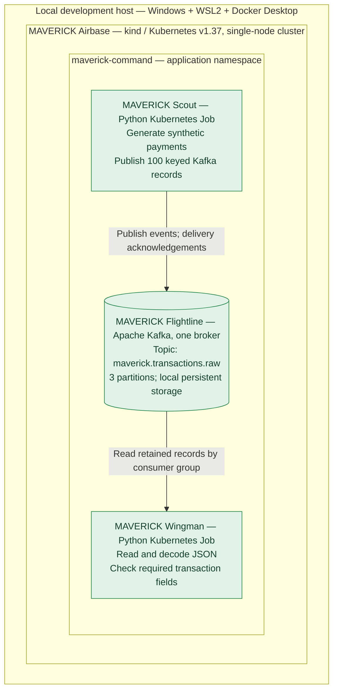
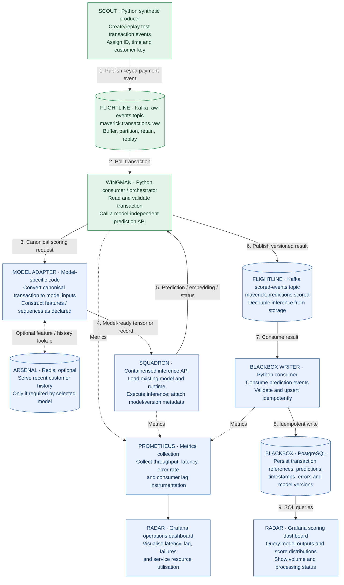
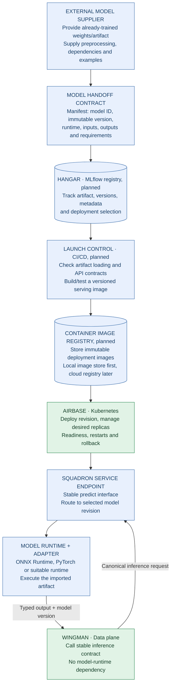
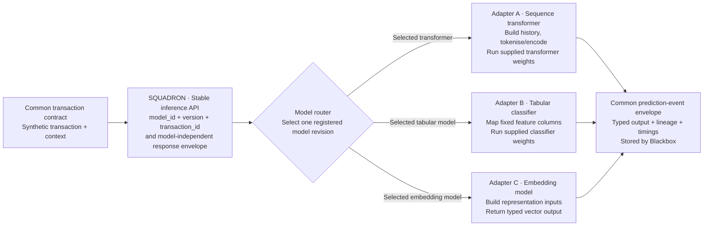
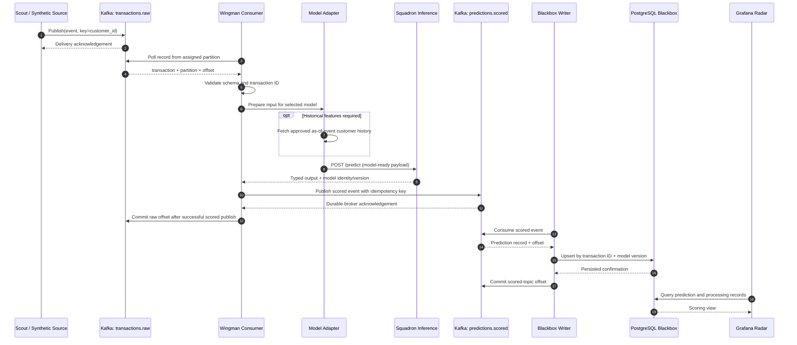
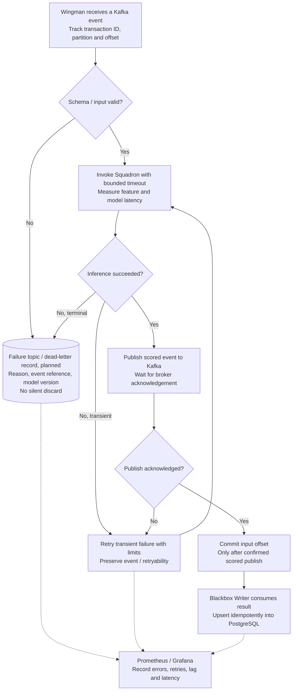
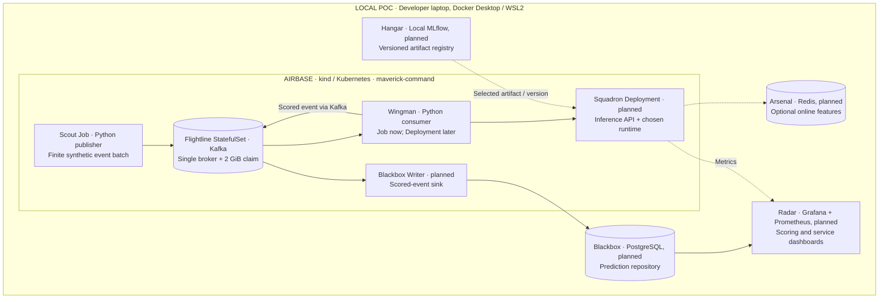

# MAVERICK

**A vendor-independent, model-agnostic proof of concept for deploying pretrained models against streaming financial transactions.**

MAVERICK explores the engineering journey from an **existing, trained model artifact** to an independently operated inference service. It combines synthetic transactions, Kafka event streaming, Kubernetes deployment, versioned model interfaces, prediction persistence and observability.

The project is **local-first and GCP-aligned**. It does not require a paid cloud environment, a proprietary fraud platform, access to real payment systems or model training.

> **Current status:** Kubernetes, Kafka and the synthetic transaction publisher are operational. The consumer application and smoke-test Job have been created; its final outcome was reported as complete. **Model inference, scored-event persistence, dashboards and model lifecycle automation are planned**, not yet deployed.
>
> 
> **Boundary:** MAVERICK performs **asynchronous, non-authoritative scoring**. It does not authorise payments, return decisions to an originating payment system or reproduce fraud case management.

## What MAVERICK aims to prove

1. **Model freedom:** Accept externally trained model artifacts with a documented input/output and preprocessing contract.
2. **Deployment independence:** Host models using portable containers and Kubernetes, without a vendor-specific model runtime.
3. **Separation of concerns:** Keep event ingestion, model execution, storage and monitoring independently replaceable.
4. **Operational control:** Manage versions, restarts, retries, observability and later horizontal scaling.
5. **Reproducibility:** Demonstrate these capabilities locally using synthetic or appropriately licensed public data.

**Not goals:** Training, fine-tuning, hyperparameter optimisation, measuring fraud-detection accuracy, connecting to live financial systems, proving high availability or claiming bank-scale capacity on one laptop.

---

## 1. What exists today: As-built architecture

This diagram represents **deployed or implemented components only**. It must not be confused with the target design below.



### As-built status and evidence

| Component | What it does now | Evidence / limitation |
| --- | --- | --- |
| **Airbase** (`maverick-airbase`) | Hosts local workloads in a single-node kind Kubernetes cluster | Control-plane node reported `Ready` |
| **Command** (`maverick-command`) | Groups application resources in a Kubernetes namespace | Namespace reported `Active` |
| **Scout** (`maverick-scout`) | Generates synthetic payments and publishes them with the customer ID as Kafka key | **100 delivered, 0 failed, 0 outstanding** in Job logs |
| **Flightline** (`maverick-flightline-kafka`) | Stores and serves transaction events from a partitioned Kafka topic | Broker pod `Running`; 2 GiB persistent claim `Bound`; manual publish/consume test passed |
| **Wingman** (`maverick-wingman`) | Reads Kafka events, parses JSON and validates required fields | Consumer Job implemented; completion reported by project owner; final Job logs not independently reviewed here |

This proves **container execution, basic orchestration and event delivery**. It does **not yet** prove model scoring, production resilience or sustained throughput. Scout and Wingman are finite Kubernetes **Jobs**, not always-on services.

---

## 2. Target architecture: End-to-end scoring data plane

The **data plane** moves a synthetic transaction from ingestion to a stored prediction. Every box states its technology and responsibility; solid arrows are data flows. Dashed arrows show optional dependencies or telemetry.



**Legend:** Green = current implementation exists (some responsibilities will be extended); blue = planned. The two Flightline boxes are **different Kafka topics on the same broker**, not two brokers.

**Important boundaries:**

- **No response to Scout.** A model result goes to the scored topic, repository and dashboards, not back to the transaction generator.
- **No forced Redis dependency.** A model that needs only the current event bypasses Arsenal; a sequence model may request historical context.
- **No assumption that every output is a fraud probability.** A pretrained model might return a class, score, embedding or another declared output. Downstream records must identify the output type and meaning.
- **No training in this flow.** Only inference against an imported artifact.
- **Model-specific processing is isolated.** Wingman should not contain hard-coded transformer tokenisation or feature mappings.

### Data plane ownership

| Component | Single responsibility | Does **not** own |
| --- | --- | --- |
| **Scout** | Create synthetic events and publish them | Model selection, scoring, production payment feeds |
| **Flightline** | Transport, retain and replay event records | Feature computation, model inference |
| **Wingman** | Validate and coordinate asynchronous scoring | Trained model weights, algorithm-specific preprocessing |
| **Model adapter** | Convert a canonical event into the selected model's inputs | Kafka storage, model training |
| **Arsenal** | Provide model-required online historical state | Model registry, permanent prediction audit |
| **Squadron** | Load and execute an imported model; return its declared output | Event ingestion, payment decisions |
| **Blackbox Writer** | Turn scored events into durable, idempotent records | Model inference |
| **Blackbox** | Store versioned outputs and processing metadata | Streaming or visualisation |
| **Radar** | Visualise scoring and system behaviour | Persisting the source-of-truth predictions |

---

## 3. Model lifecycle: Control plane and plug-and-play deployment

The **control plane** determines which approved artifact runs. Its lifecycle is independent of the transactions arriving continuously in the data plane.



**Model swapping:** Deploying another model changes the model artifact, its adapter, the runtime image (if needed) and routing/configuration. The transaction producer, raw Kafka topic, repository contract and dashboards remain unchanged. A registry alias alone does **not** update a running deployment; Launch Control must perform a release.

### Proposed minimal model package

```text
model-package/
  manifest.yaml             # ID, version, task, runtime, artifact checksum
  artifact/                 # Pretrained model, or approved artifact reference
  input-schema.json         # Expected input fields / tensor specification
  output-schema.json        # Prediction or embedding schema and meaning
  adapter/                  # Model-specific feature transformation
  sample-input.json         # Deterministic engineering smoke-test fixture
  expected-output-shape.json
  requirements.lock         # Reproducible runtime dependencies
```

**Contract checks are not model training or predictive-quality validation.** They establish that an existing artifact loads, processes valid inputs, produces an output of the declared shape and reports its version.

### Model-agnostic boundary



The diagram shows **alternative supported integration patterns**, not three models invoked per transaction or currently deployed. The router selects one model revision for each scoring request. The common envelope is stable; the model-specific input contract remains explicit. An embedding is **not** relabelled as a fraud score.

---

## 4. Event lifecycle: One transaction end to end (planned)

This sequence shows the intended message and acknowledgement boundaries. It highlights where **durability** and **consumer offsets** matter.



**Delivery semantics:** The target is **at-least-once processing with idempotent downstream writes**, not an unsupported promise of exactly-once end-to-end delivery. If the consumer crashes after publishing a result but before committing its input offset, it may replay the transaction. Blackbox must therefore prevent duplicate results using a stable logical key. Kafka delivery guarantees depend on broker health and replication; one local broker is not highly available.

**Historical feature correctness:** For sequence-based models, features must reflect information available **as of the transaction's event time**. Ordering, late arrival, replays and state recovery require explicit policies in a later stage.

---

## 5. Reliability, failures and observability (target behaviour)



This is a **design goal**, not functionality already implemented. Production-style error policies must additionally specify retry limits, poison-message handling, dead-letter acknowledgement and operational reprocessing. Failed messages should never be silently marked successful.

**Two different views in Radar:**

- **Scoring view (PostgreSQL source):** transaction ID, model ID/version, output type, score distribution where applicable, prediction counts and processing status.
- **Operations view (Prometheus source):** ingestion rate, consumer lag, end-to-end and inference p95/p99 latency, error and retry rates, pod health, CPU/memory and restarts.

---

## 6. Deployment topology and GCP alignment

A single-node local cluster reproduces the **Kubernetes resource and application boundary**, not the size or resilience of an enterprise estate.



This is a **logical topology**. The future supporting services can run inside or outside the kind cluster depending on available RAM; the production design uses equivalent interfaces either way.

| Local component | Potential Google Cloud mapping | Portability note |
| --- | --- | --- |
| **Airbase** (kind Kubernetes) | Google Kubernetes Engine (GKE) | Reuse Kubernetes manifests and container contracts with production-specific changes |
| **Flightline** (Apache Kafka) | Google Managed Service for Apache Kafka, or approved Kafka estate | Broker addresses, credentials, capacity and retention change |
| **Squadron** (Python / ONNX Runtime or compatible server) | Containerised inference on GKE, optionally managed serving | Runtime choice follows artifact format and latency needs |
| **Arsenal** (Redis, optional) | Memorystore or approved online store | Feature consistency and durability need separate design |
| **Blackbox** (PostgreSQL) | Cloud SQL or an approved operational store | Large-scale analytics might use a separate warehouse |
| **Hangar** (MLflow) | Managed or self-hosted artifact/model registry | Must preserve artifact version and provenance |
| **Radar** (Grafana / Prometheus) | Cloud Monitoring, managed Prometheus and/or Grafana | Dashboard queries and instrumentation remain conceptually portable |
| **Launch Control** (CI/CD) | Cloud Build, Artifact Registry, deployment tooling | IAM and release controls differ in enterprise use |

**Cost constraint:** Run local development first. Cloud deployment, GPU inference, multi-node Kafka, KServe and specialised serving gateways are optional experiments, not prerequisites. Container images and runtime dependencies should be pinned in reproducible releases.

---

## 7. Repository layout

The following reflects **current files plus planned folders**. Planned paths are explicitly labelled.

```text
maverick/
├── infrastructure/
│   ├── kafka/
│   │   └── flightline.yaml          # Existing single-broker deployment
│   ├── scout/
│   │   └── scout-job.yaml          # Existing 100-event batch Job
│   ├── wingman/
│   │   └── wingman-job.yaml        # Existing consumer smoke-test Job
│   ├── squadron/                 # Planned inference workload
│   ├── blackbox/                 # Planned database and writer
│   └── radar/                    # Planned monitoring
├── services/
│   ├── scout/
│   │   ├── scout.py
│   │   └── Dockerfile
│   ├── wingman/
│   │   ├── wingman.py
│   │   └── Dockerfile
│   ├── squadron/                 # Planned inference server and adapters
│   └── blackbox-writer/          # Planned results consumer
├── models/
│   └── catalog/                  # Planned PUBLIC model manifests only
└── tests/                        # Planned tests and benchmarks
```

## 8. Run the current proof of concept

### Prerequisites

- Docker Engine / Docker Desktop with Linux containers
- `kind`, `kubectl`, and sufficient local memory for one Kafka broker and a single-node cluster
- The repository's existing configuration files as shown above

The reference development environment uses Windows + WSL2 + Ubuntu. Equivalent Linux environments should work with appropriate configuration.

### 1. Create Airbase

```bash
kind create cluster --name maverick-airbase --wait 5m
kubectl create namespace maverick-command --dry-run=client -o yaml | kubectl apply -f -
kubectl get nodes
```

Skip cluster creation if `maverick-airbase` already exists.

### 2. Start Flightline and create its topic

```bash
kubectl apply -f infrastructure/kafka/flightline.yaml
kubectl rollout status statefulset/maverick-flightline-kafka \
  -n maverick-command --timeout=240s
kubectl get pods,pvc -n maverick-command

kubectl exec -n maverick-command maverick-flightline-kafka-0 -- \
  /opt/kafka/bin/kafka-topics.sh \
  --bootstrap-server localhost:9092 \
  --create --if-not-exists \
  --topic maverick.transactions.raw \
  --partitions 3 --replication-factor 1
```

### 3. Build and run Scout

```bash
docker build -t maverick-scout:0.1.0 services/scout
kind load docker-image maverick-scout:0.1.0 --name maverick-airbase
kubectl apply -f infrastructure/scout/scout-job.yaml
kubectl wait --for=condition=complete \
  job/maverick-scout-batch-001 -n maverick-command --timeout=120s
kubectl logs job/maverick-scout-batch-001 -n maverick-command
```

Expected initial result:

```text
Delivered: 100, Failed: 0, Remaining: 0
```

### 4. Build and run Wingman

```bash
docker build -t maverick-wingman:0.1.0 services/wingman
kind load docker-image maverick-wingman:0.1.0 --name maverick-airbase
kubectl apply -f infrastructure/wingman/wingman-job.yaml
kubectl wait --for=condition=complete \
  job/maverick-wingman-smoke-001 -n maverick-command --timeout=120s
kubectl logs job/maverick-wingman-smoke-001 -n maverick-command
```

A completed Kubernetes Job will not rerun simply because its manifest is applied again. Use a new Job name for a new batch, and manage consumer-group offsets deliberately. Kafka data stored inside kind is **not guaranteed to survive deletion of the kind cluster**; retaining a PVC alone does not make it an external backup.

```bash
kubectl get pods,jobs,pvc -n maverick-command
```

---

## 9. Data contracts and persistence (planned)

**Raw transaction envelope** (illustrative, all values synthetic):

```json
{
  "schema_version": 1,
  "transaction_id": "MAV-000001",
  "customer_id": "CUST-001",
  "amount_minor": 25000,
  "currency": "GBP",
  "event_type": "OUTBOUND_PAYMENT",
  "event_timestamp": "2026-11-01T10:00:00Z",
  "source": "maverick-scout"
}
```

**Scored event envelope** (illustrative):

```json
{
  "schema_version": 1,
  "transaction_id": "MAV-000001",
  "model_id": "demo-transformer",
  "model_version": "1.0.0",
  "output_type": "classification_score",
  "prediction": {"score": 0.73},
  "scored_at": "2026-11-01T10:00:01Z",
  "status": "SUCCESS"
}
```

The prediction `0.73` is **illustrative**, not a result from a deployed model. A future Blackbox schema will retain source event time, ingestion time, model version, status, relevant latency measurements and a stable idempotency key (for example `transaction_id + model_id + model_version`). Reprocessing policy must explicitly define when multiple scores for one transaction are intentional.

## 10. Roadmap and acceptance criteria

| Milestone | State | Evidence required |
| --- | --- | --- |
| Local Kubernetes foundation | **Implemented** | Node Ready; namespace exists; test container served HTTP |
| Kafka ingestion | **Implemented** | Broker Running; topic created; sample record read back |
| Scout publisher | **Implemented** | 100 acknowledged records; zero producer failures |
| Wingman consumer | **Implemented / reported tested** | Job logs showing valid message count and completion |
| Squadron model inference | **Planned** | Genuine pretrained artifact returns a typed output from a Kubernetes service |
| Scored-event stream and Blackbox | **Planned** | Scored Kafka records persisted once by logical result key |
| Radar dashboards | **Planned** | Score/throughput/latency/error charts driven by real test data |
| Hangar and model switching | **Planned** | Two compatible pretrained artifacts deployed without changing the ingestion pipeline |
| Reliability and scale tests | **Planned** | Replay, outage recovery, throughput and p95/p99 latency report |
| GCP reference deployment | **Planned / optional** | Documented infrastructure mapping; cloud run only within a defined budget |

Benchmarking should **separate Kafka ingestion throughput from actual model inference throughput**. One million messages read from Kafka does not mean one million transformer predictions were completed.