# MAVERICK | Living engineering progress journal

> **Last verified update:** 6 November 2026  
> **Project:** MAVERICK, an independent, model-agnostic fraud-model productionisation proof of concept  
> **Source of truth:** This document records **observed results and commands reported during the build**, rather than describing planned components as operational.  
> **Last completed milestone:** **MAVERICK SQUADRON HTTP INFERENCE PASSED**  
> **Next milestone:** Build and verify a self-contained Squadron release image before deploying it to Kubernetes. **This has not yet been performed.**
>
> **How to use this document:** Append a dated session entry, update the verification matrix, revise diagrams when implementation changes, and retain failed experiments and their resolutions. Do not replace historical evidence with intended outcomes.
>
> Related document: [MAVERICK architecture and long-term design](../README.md).

## 0. Executive recap: What have we proved?

MAVERICK is a personal, low-cost, vendor-independent experiment in serving **externally trained models** against **synthetic payment events**. It is designed to demonstrate deployment and operating flexibility, not to train models or establish real-world fraud detection accuracy.

We have independently demonstrated **two chains of functionality**, but have **not connected them together yet**:

1. **Streaming ingestion:** A Python Scout Kubernetes Job published **100 synthetic outbound-payment records** into a three-partition Kafka topic. A Python Wingman Kubernetes Job read and validated the records, observed **100 valid Scout events**, skipped one earlier manual test event, committed its offsets, and passed.
2. **Local model serving:** We inspected and downloaded a community pretrained bank-transfer fraud classifier, diagnosed a scikit-learn serialisation incompatibility, reproduced its published output in an isolated Docker smoke test, recreated that output through our own model adapter, and exposed the model through a **local FastAPI HTTP endpoint**. The final HTTP test printed **`MAVERICK SQUADRON HTTP INFERENCE PASSED`**.

**Not yet verified:** Wingman calling Squadron, historical feature computation from raw Scout payments, Squadron running inside Kubernetes, scored Kafka events, PostgreSQL persistence, Grafana, MLflow, CI/CD or GCP deployment.

### Evidence and status matrix

| Stage | Component / test | Verified evidence | Status |
| --- | --- | --- | --- |
| Foundation | Windows / WSL2, Docker Desktop, kind, kubectl | Local Airbase Kubernetes node `Ready` | **Verified earlier** |
| Foundation | `maverick-command` namespace | Namespace `Active` | **Verified earlier** |
| Streaming | Flightline Kafka 4.4.0, one KRaft broker | Broker `Running`, 2 GiB PVC `Bound`, topic created | **Verified earlier** |
| Streaming | Topic `maverick.transactions.raw` | Three partitions, replication factor one | **Verified earlier** |
| Streaming | Scout batch Job | `Delivered: 100, Failed: 0, Remaining: 0` | **Passed** |
| Streaming | Wingman smoke-test Job | `Scout transactions processed: 100`; `Other events skipped: 1`; `MAVERICK Wingman test PASSED` | **Passed** |
| Artifact | Pretrained transfer-fraud model | 702,984-byte `model.joblib`; recorded SHA256 below | **Downloaded / inspected** |
| Runtime | Initial model smoke test with scikit-learn 1.9.1 | `ModuleNotFoundError: No module named '_loss'` | **Failed, diagnosed** |
| Runtime | Corrected smoke test with scikit-learn 1.8.0 | `fraud_probability: 0.997`, `risk_level: 3`, `critical` | **Passed** |
| Adapter | `TransferFraudAdapter` functional test | Baseline matched; missing feature rejected | **Passed** |
| API | `contracts.py`, `main.py` syntax checks | Python compilation successful | **Passed: syntax** |
| API | Squadron Docker image | `maverick-squadron:0.1.0`, image ID `a48bf7445b49` | **Built** |
| API | Local HTTP request to `POST /v1/predict` | `MAVERICK SQUADRON HTTP INFERENCE PASSED` | **Passed** |
| Release | Bundled model image `maverick-squadron:0.2.0` | No build result reported | **Not started / unverified** |
| Operations | Squadron Kubernetes Deployment / Service | No manifests applied | **Planned** |
| Data processing | Historical-feature adapter for live Scout records | No implementation | **Planned** |
| Outcomes | Scored topic, Blackbox, Radar | No implementation | **Planned** |

### Diagram 1: What is implemented today versus planned

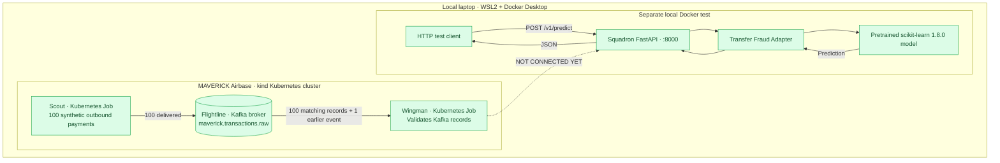

**Crucial architectural truth:** The green streaming path and green inference path work independently. A dotted line is **not evidence of integration**.

---

## 1. Objectives, boundaries and working environment

### Business / engineering objective

Provide a portable, model-independent system for importing an **already-trained** fraud model, packaging its dependencies and preprocessing, executing inference, recording versioned results and observing runtime behaviour. The practical baseline is **synthetic outbound bank transfers**.

- **Included:** synthetic data, Kafka, containerised Python services, model adapters, independent inference, Kubernetes, later PostgreSQL and Grafana.
- **Excluded:** model training, tuning, fine-tuning, production bank connectivity, payment authorisation, business decision policy and fraud-case management.
- **Design constraint:** model-specific feature engineering belongs to an adapter, not to Wingman or the generic Squadron API.
- **Training provenance:** the selected classifier was reportedly trained using **synthetic** transfers. Publisher accuracy metrics are not a validated measure of real-world performance.
- **Deployment boundary:** Kafka and consumer are currently inside kind; Squadron runs as a local Docker container on the host.
- **Cost constraint:** local CPU-serving first; cloud/GKE is an optional later demonstration, not a requirement.

### Technology stack used and reasons

| Technology | Why selected | Where used |
| --- | --- | --- |
| Windows + WSL2 Ubuntu | Linux tooling on the existing laptop | Development shell |
| Docker Desktop / Docker | Reproducible runtimes and local container images | Scout, Wingman, Kafka node, model smoke test, Squadron |
| kind | Local Kubernetes without a GCP bill | `maverick-airbase` cluster |
| Kubernetes | Pods, Jobs, services, persistence, lifecycle | Airbase; later Squadron Deployment |
| Apache Kafka 4.4.0 KRaft | Decoupled event transport and replay | Flightline |
| Python + `confluent_kafka` | Producer and consumer clients | Scout / Wingman |
| Hugging Face Hub | Public model repository and pinned artifact revision | Model discovery |
| scikit-learn 1.8.0 | Actual binary compatibility with imported model | Squadron runtime |
| joblib | Loads existing scikit-learn model | Model inspector / adapter |
| pandas | Exact ordered tabular inputs for trained classifier | Adapter |
| FastAPI + Pydantic | HTTP serving and request/response validation | Squadron |
| Uvicorn | ASGI server executing FastAPI | Squadron |

Hardware reference for the POC: laptop-class Intel CPU, **16 GB system RAM**, NVIDIA RTX 4060 laptop GPU (8 GB VRAM). Current classifier uses **CPU inference**, not GPU acceleration.

### Diagram 2: Component responsibility boundaries

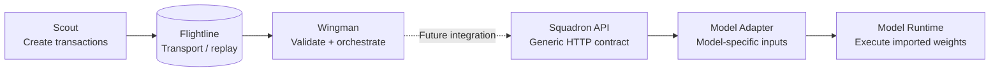

The adapter's first version takes **precomputed** features; it does **not** yet compute customer history. Keeping the external contract generic does not make an incompatible feature set automatically usable.

---

## 2. Foundation: Airbase, Flightline and the raw-events topic

### 2.1 Airbase: local Kubernetes cluster

- Cluster name: `maverick-airbase`.
- Application namespace: `maverick-command`.
- Local tooling: Docker Desktop, kind, kubectl.
- Kubernetes version observed earlier: kind Kubernetes **v1.37.0**.
- Single-node local test deployment, **not highly available**.

Reference commands used during foundation work (avoid recreating an existing cluster):

```bash
kind create cluster --name maverick-airbase --wait 5m
kubectl create namespace maverick-command \
  --dry-run=client -o yaml | kubectl apply -f -
kubectl get nodes
kubectl get namespace maverick-command
```

- `kind create cluster` creates Kubernetes nodes as Docker containers; `--wait 5m` waits for readiness, not guaranteed success.
- The namespace groups resources logically; it is not a separate Kubernetes cluster.
- `kubectl get` inspects the live cluster rather than changing it.

### Diagram 3: Airbase hierarchy

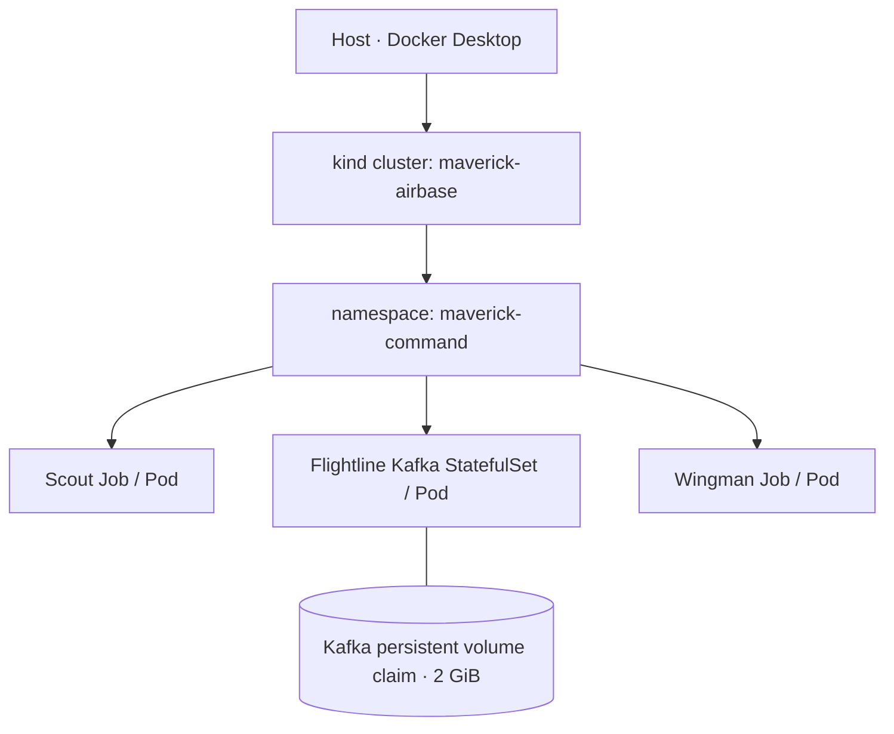

A Kubernetes **Job** completes a finite task. A **StatefulSet** maintains a stable Kafka broker identity and attaches persistent storage. Later, Squadron will use a **Deployment** for a continuously running HTTP service.

### 2.2 Flightline: Kafka broker and topic

- Manifest: `infrastructure/kafka/flightline.yaml` (local WSL project).
- StatefulSet: `maverick-flightline-kafka`.
- One Kafka 4.4.0 broker using KRaft mode.
- Persistent claim: 2 GiB, previously `Bound`.
- Raw topic: `maverick.transactions.raw`.
- Partitions: **3**. Replication factor: **1** (appropriate only to this local single-broker POC).
- Inside-cluster bootstrap host: `maverick-flightline-kafka-0.maverick-flightline-kafka.maverick-command.svc.cluster.local:9092`.
- Local-only PLAINTEXT transport; not production TLS/authentication.

Reference verification / creation commands:

```bash
kubectl apply -f infrastructure/kafka/flightline.yaml
kubectl rollout status statefulset/maverick-flightline-kafka \
  -n maverick-command --timeout=240s
kubectl get pods,pvc -n maverick-command

kubectl exec -n maverick-command maverick-flightline-kafka-0 -- \
  /opt/kafka/bin/kafka-topics.sh \
  --bootstrap-server localhost:9092 \
  --create --if-not-exists \
  --topic maverick.transactions.raw \
  --partitions 3 --replication-factor 1
```

Manually publishing and consuming one earlier event proved the broker could accept and return an event before Scout was introduced. That event lacked Scout's expected `source`, explaining Wingman's later **one skipped event**.

### Diagram 4: Kafka message flow and partitioning

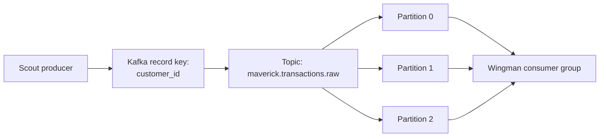

Using `customer_id` as the Kafka key keeps records for that customer on the same partition under the current partitioning configuration. Kafka preserves order **within a partition**, not across all three partitions. This does not, by itself, solve event-time ordering or late-arriving updates.

---

## 3. Scout: synthetic outbound payment production

### 3.1 What was implemented

Local files:

- `services/scout/scout.py`
- `services/scout/Dockerfile`
- `infrastructure/scout/scout-job.yaml`

Scout is a Python `confluent_kafka.Producer`, packaged as `maverick-scout:0.1.0`, run as a Kubernetes **batch Job** named `maverick-scout-batch-001`. It generated **100** synthetic outbound payment records using a fixed random seed for repeatability.

Example record shape (illustrative values; not an actual captured message):

```json
{
  "schema_version": 1,
  "transaction_id": "MAV-example-uuid",
  "customer_id": "CUST-0008",
  "amount_minor": 18389,
  "currency": "GBP",
  "event_type": "OUTBOUND_PAYMENT",
  "event_timestamp": "2026-11-06T12:00:00Z",
  "source": "maverick-scout"
}
```

- `amount_minor` is in **minor currency units** (e.g. pence); the selected classifier expects an amount in a model-training-compatible currency and unit, which remains unresolved for genuine integration.
- `transaction_id` identifies the event; `customer_id` provides the Kafka routing key.
- `source` distinguishes generated payments from manually published test records.
- The present event schema lacks beneficiary ID and historical behavioural features required for model inference.

### Diagram 5: Scout internal flow

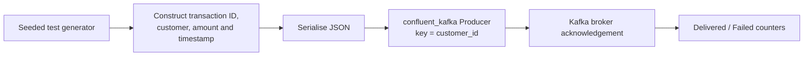

The producer used delivery acknowledgements, `acks=all`, idempotence and `flush(30)` at shutdown. **An acknowledged send is not equivalent to an end-to-end scored transaction.**

### 3.2 Container and Job run

```bash
docker build -t maverick-scout:0.1.0 services/scout
kind load docker-image maverick-scout:0.1.0 --name maverick-airbase
kubectl apply -f infrastructure/scout/scout-job.yaml
kubectl wait --for=condition=complete \
  job/maverick-scout-batch-001 -n maverick-command --timeout=120s
kubectl logs job/maverick-scout-batch-001 -n maverick-command
```

Observed success:

```text
Delivered: 100, Failed: 0, Remaining: 0
```

- `docker build -t` packages the producer as an image with a version tag.
- `kind load docker-image` copies the **local image** into the local kind node; it is not a push to a remote registry.
- `kubectl apply -f` submits the Job manifest.
- `kubectl wait` confirms that Kubernetes marked the finite Job complete.
- `kubectl logs` gives application-level delivery evidence.

---

## 4. Wingman: Kafka consumption and validation

### 4.1 What was implemented

Local files:

- `services/wingman/wingman.py`
- `services/wingman/Dockerfile`
- `infrastructure/wingman/wingman-job.yaml`

Wingman initially runs as a **finite smoke-test Job**, not a permanent scoring worker. It uses a `confluent_kafka.Consumer` in group `maverick-wingman-smoke-v1` and:

1. Subscribes to `maverick.transactions.raw`.
2. Polls records, decodes JSON and checks required fields.
3. Recognises records with `source = "maverick-scout"`.
4. Counts accepted and other events.
5. Stops after **100** valid Scout records.
6. Commits the successfully processed offsets synchronously, with automatic commits disabled.

### Diagram 6: Wingman event validation

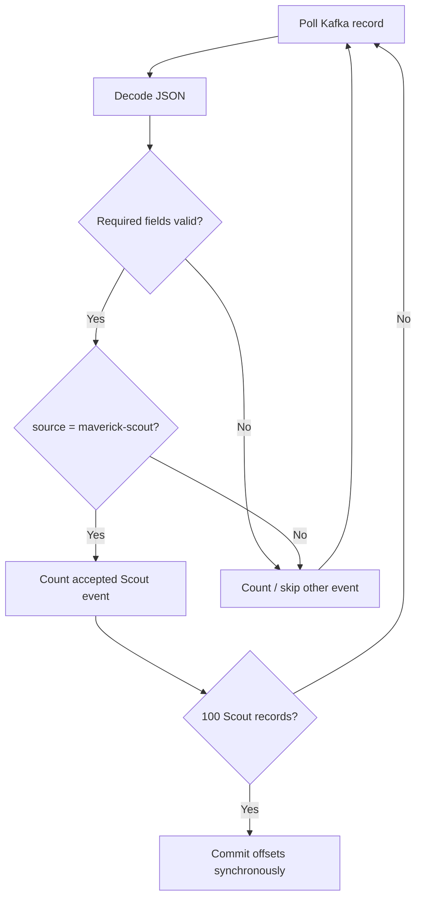

A consumer offset records progress **within the Kafka consumer group**. Offset commits alone don't guarantee exactly-once end-to-end processing once inference and database writes are introduced; we will need explicit idempotency.

### 4.2 Container and Job run

```bash
docker build -t maverick-wingman:0.1.0 services/wingman
kind load docker-image maverick-wingman:0.1.0 --name maverick-airbase
kubectl apply -f infrastructure/wingman/wingman-job.yaml
kubectl wait --for=condition=complete \
  job/maverick-wingman-smoke-001 -n maverick-command --timeout=120s
kubectl logs job/maverick-wingman-smoke-001 -n maverick-command
```

Observed:

```text
Scout transactions processed: 100
Other events skipped: 1
MAVERICK Wingman test PASSED
```

**Acceptance:** The Scout-to-Kafka-to-Wingman ingestion smoke test is complete. No prediction was made from these Kafka events.

---

## 5. Model research and selection: Bank transfer fraud

### 5.1 Why we chose this model first

We deliberately selected a **bank-transfer fraud classifier** rather than a transformer, because our synthetic event type is `OUTBOUND_PAYMENT` and our immediate objective is **productionisation**, not training or architecture novelty. A sequence transformer remains a later second-model portability test.

Selected public artifact:

- Hugging Face: [yssfmlha/transfer-fraud-model](https://huggingface.co/yssfmlha/transfer-fraud-model)
- Hugging Face immutable repository revision: `273172cbaeb4080112124721ac213b026c86a963`.
- Publisher-declared licence: **MIT**.
- Published algorithm: `HistGradientBoostingClassifier` (binary classifier).
- Inputs: **15 precomputed numerical features**.
- Output: estimated fraud probability, plus derived risk level and label.
- Claimed training/evaluation: **synthetic** transfer data, therefore no production accuracy claim.

### Diagram 7: Model selection gate

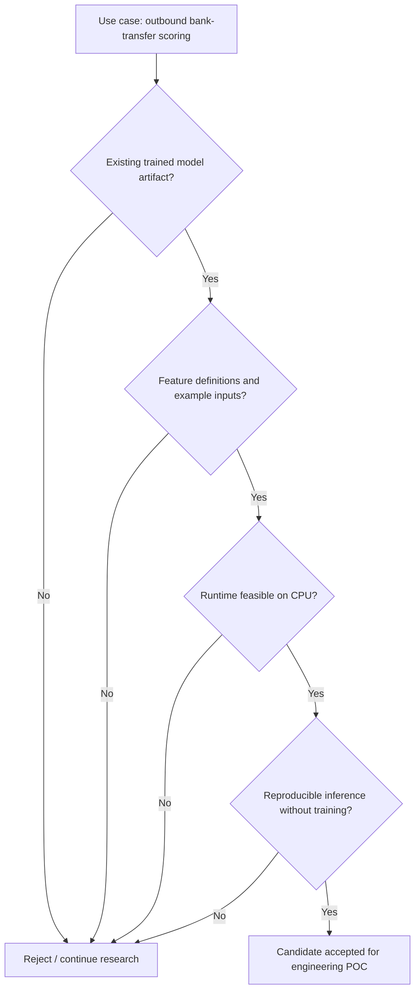

NVIDIA's transaction foundation model remains a reference for a **later** transformer adapter. Its representation/embedding output is not inherently a fraud probability and should not be presented as one.

### 5.2 Repository discovery and download

The model's public Hub metadata was inspected using Python's standard-library `urllib.request.urlopen` with:

```text
https://huggingface.co/api/models/yssfmlha/transfer-fraud-model
```

Observed files:

```text
.gitattributes
README.md
config.json
model.joblib
predict.py
```

Downloaded **README.md**, **config.json**, **predict.py**, then **model.joblib** from the **pinned revision** into:

```text
research/model-candidates/transfer-fraud/
```

Artifact checksum (SHA256):

```text
8cba4b47479205b848ade806b8b06b3171d8f700e5ce099aa85eabeb8586d00a
```

Artifact size: **702,984 bytes** (approximately 687 KiB). Linux `file` described it as `data`, which is not itself a failure for a Python serialisation format.

Reverification command:

```bash
echo "8cba4b47479205b848ade806b8b06b3171d8f700e5ce099aa85eabeb8586d00a  research/model-candidates/transfer-fraud/model.joblib" \
  | sha256sum -c -
```

**Important:** The SHA256 is a **locally recorded fingerprint**, not an independent authenticity attestation. `joblib.load()` uses pickle-style deserialisation and can execute code. Pinning a Hub commit is reproducibility control, not proof of trust.

### Diagram 8: Where model files fit

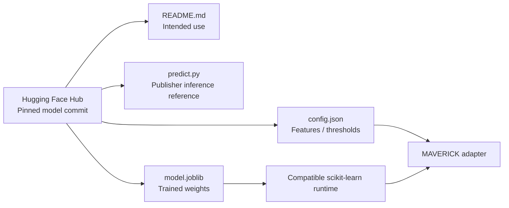

### 5.3 The exact 15-feature contract

These names are ordered as recorded in `config.json`. **Order matters when creating the pandas DataFrame supplied to the classifier.**

| # | Feature | Meaning |
| ---: | --- | --- |
| 1 | `amount` | Payment amount in the training-compatible currency/unit |
| 2 | `hour` | Customer-local decimal hour |
| 3 | `day_of_week` | Monday=0 through Sunday=6 |
| 4 | `history_count` | Earlier sender transfers in the last 180 days |
| 5 | `is_new_destination` | Whether destination is absent from earlier 180-day history |
| 6 | `times_sent_to_destination` | Earlier transfers to same destination |
| 7 | `days_since_last_to_destination` | Days since previous payment there; -1 if none |
| 8 | `amount_vs_avg` | Current amount / preceding average amount |
| 9 | `amount_zscore` | Standardised current amount relative to preceding history |
| 10 | `amount_vs_max` | Current amount / previous maximum amount |
| 11 | `hour_familiarity` | Share of prior transactions close to current local hour |
| 12 | `hours_since_last_transfer` | Time since preceding sender transfer; -1 if none |
| 13 | `transfers_last_1h` | Prior transfers in previous hour |
| 14 | `transfers_last_24h` | Prior transfers in previous 24 hours |
| 15 | `distinct_destinations_last_24h` | Distinct prior beneficiaries in previous day |

All history must use **strictly earlier** events, without leaking the transaction currently being scored. The model documentation defines a 180-day reference history. Missing-history defaults are documented in `config.json` and must be applied **only when the stated condition is true**.

### Diagram 9: Why raw Scout payments are not ready for this model

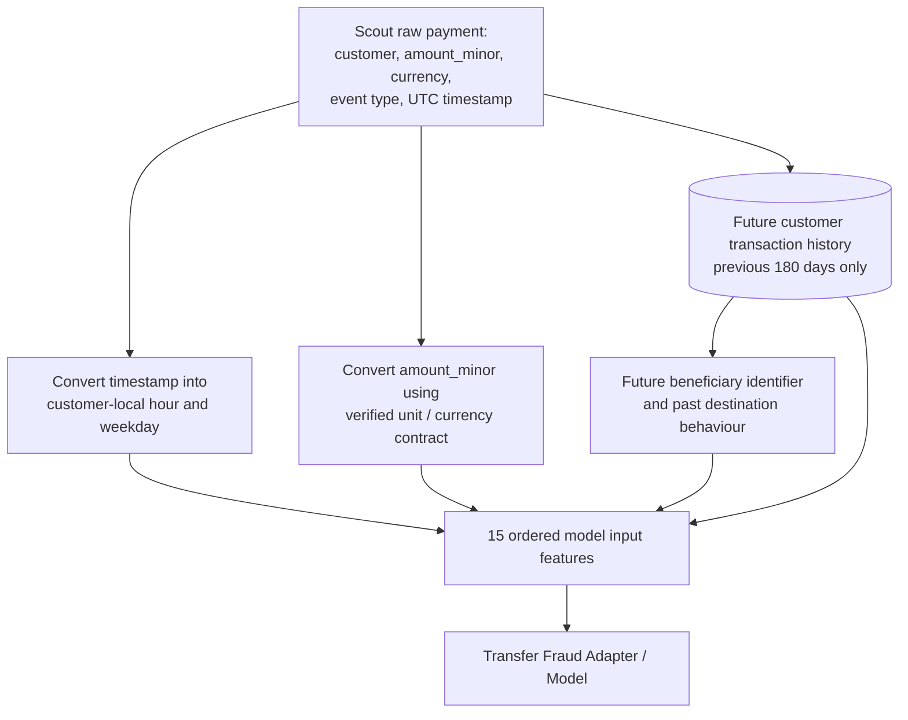

**Current gap:** Scout does not yet provide a beneficiary ID, customer local timezone or persisted transfer history. We must not invent these values merely to obtain successful predictions. The training currency is not specified in the publisher documentation, so mapping GBP to `amount` is not yet approved. Our successful tests use the **publisher's fully populated example fixture**, not raw Scout events.

### 5.4 Understanding the probability-to-risk conversion

```text
0.0000 to <0.0053       → level 0: low
0.0053 to <0.0819       → level 1: elevated
0.0819 to <0.5633       → level 2: high
0.5633 to 1.0000        → level 3: critical
```

Publisher-reported test metrics: ROC-AUC `0.9924`, PR-AUC `0.8382`, test fraud rate `0.0169`. These values refer to the publisher's synthetic test distribution; they have **not** been independently reproduced on a representative real-world sample.

---

## 6. First model execution: Runtime incompatibility and fix

### 6.1 Original isolated smoke test

Local testing files:

```text
research/model-candidates/transfer-fraud/smoke-test/Dockerfile
research/model-candidates/transfer-fraud/smoke-test/smoke_test.py
```

Initial image: `maverick-model-inspector:0.1.0`, using `python:3.12-slim` and a broad scikit-learn range (`>=1.4,<2`).

The smoke test:

1. Read `config.json`.
2. Loaded the externally supplied `model.joblib`.
3. Checked model class ordering.
4. Called the publisher's `FraudModel.predict()` on `example_input`.
5. Validated the output's probability and classification.

The model **failed to load**, with:

```text
Scikit-learn version: 1.9.1
Required features: 15
ModuleNotFoundError: No module named '_loss'
```

The error occurred **during model deserialisation**, before prediction. It was not caused by transaction feature values or Kafka.

### 6.2 Inspect binary version metadata without loading it

A read-only byte search for `_sklearn_version` inside the 702,984-byte artifact yielded:

```text
Version markers found: 1
... _sklearn_version ... 1.8.0 ...
References to _loss: 4
```

Relevant safe inspection logic:

```python
from pathlib import Path
import re

data = Path("research/model-candidates/transfer-fraud/model.joblib").read_bytes()
for marker in re.finditer(rb"_sklearn_version", data):
    print(repr(data[marker.start():marker.start() + 100]))
print("References to _loss:", data.count(b"_loss"))
```

This inspection **does not deserialise the model**. It established that the artifact records scikit-learn **1.8.0**.

### Diagram 10: Compatibility incident

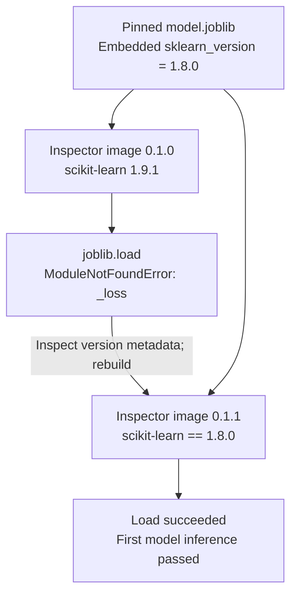

### 6.3 Fix: Exact dependency pin

Changed Dockerfile requirement to:

```dockerfile
"scikit-learn==1.8.0"
```

Then rebuilt:

```bash
docker build -t maverick-model-inspector:0.1.1 \
  research/model-candidates/transfer-fraud/smoke-test
```

The isolated test used:

```bash
docker run --rm \
  --network none \
  --read-only \
  --cap-drop ALL \
  --security-opt no-new-privileges \
  --pids-limit 64 \
  --memory 768m \
  --cpus 1 \
  --user 65534:65534 \
  --tmpfs /tmp:rw,nosuid,nodev,size=64m \
  -v "$(pwd)/research/model-candidates/transfer-fraud:/models:ro" \
  maverick-model-inspector:0.1.1
```

**Meaning of restrictions:** no network, read-only root and mounted model files, no Linux capabilities, unprivileged UID, limited memory/CPU/processes and limited writable temporary memory. These reduce attack surface; they are not a guarantee against every malicious pickled payload.

Observed successful result:

```text
MAVERICK Model Smoke Test
Scikit-learn version: 1.8.0
Required features: 15
Model classes: [np.int64(0), np.int64(1)]
Prediction: {
  "fraud_probability": 0.997,
  "risk_level": 3,
  "risk_label": "critical"
}
MAVERICK MODEL SMOKE TEST PASSED
```

**Interpretation:** `0.997` is the **model's estimated fraud probability for the publisher's specific example**. It is **not 99.7% accuracy**, nor evidence of validated financial fraud detection.

---

## 7. Our own Squadron adapter: Reproduce and validate inference

### 7.1 Source created

Local source:

```text
services/squadron/adapters/transfer_fraud.py
```

`TransferFraudAdapter` contains:

- `model_id = "transfer-fraud-v1"`.
- `model_version = "273172cbaeb4080112124721ac213b026c86a963"`.
- `output_type = "fraud_classification"`.
- The previously observed SHA256 fingerprint, checked before deserialisation.
- A load-once `__init__`, reading `config.json` and `model.joblib`.
- A class-order check, interpreting the second class as fraud.
- Strict checks for all 15 required numerical features, excluding booleans, NaN and infinity.
- Ordered DataFrame construction and model `predict_proba`.
- Threshold-to-risk label conversion.

### Diagram 11: Adapter internal processing

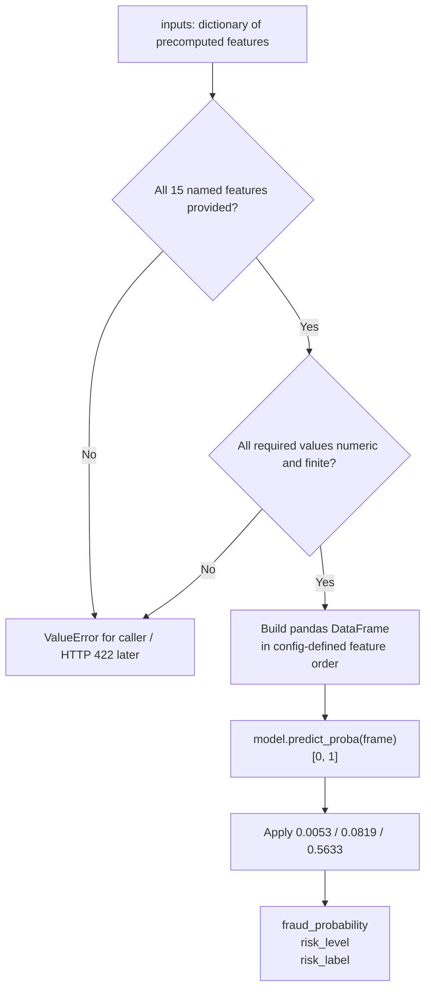

The adapter's purpose is **not** to hide the requirement for historical features; it declares and validates the model-specific contract. Building the **feature-computation** stage comes later.

### 7.2 Syntax and functional tests

Syntax tested using:

```bash
python3 -m py_compile services/squadron/adapters/transfer_fraud.py
```

Functional test reused `maverick-model-inspector:0.1.1` with the model and adapter mounted read-only. It exercised both:

1. The publisher example must reproduce exactly `{"fraud_probability":0.997,"risk_level":3,"risk_label":"critical"}`.
2. Removing `amount` must raise a `ValueError`.

Observed:

```text
Baseline prediction matched
Missing feature correctly rejected
MAVERICK SQUADRON ADAPTER TEST PASSED
```

This provides **one baseline regression assertion and one negative-input assertion**, not a comprehensive security or test suite.

---

## 8. FastAPI: Standard model-agnostic contract and HTTP service

### 8.1 Local project structure

```text
~/projects/maverick/
├── services/
│   ├── scout/
│   ├── wingman/
│   └── squadron/
│       ├── contracts.py
│       ├── main.py
│       ├── requirements.txt
│       ├── Dockerfile
│       └── adapters/
│           └── transfer_fraud.py
├── infrastructure/
│   ├── kafka/
│   ├── scout/
│   ├── wingman/
│   └── squadron/       # Created; Kubernetes resources not yet deployed
└── research/
    └── model-candidates/
        └── transfer-fraud/
            ├── README.md
            ├── config.json
            ├── predict.py
            ├── model.joblib
            └── smoke-test/
                ├── Dockerfile
                └── smoke_test.py
```

**GitHub sync note:** This directory structure describes the **local WSL workspace**. Creating this journal in GitHub does **not** automatically push the source files, image layers or model artifact. At the journal's creation, the public repository previously held the architecture README; source syncing has not been verified.

### 8.2 Generic request / response structures

`services/squadron/contracts.py` defines Pydantic structures with required nonempty identifiers and a nonempty input dictionary:

```json
{
  "transaction_id": "MAV-HTTP-001",
  "model_id": "transfer-fraud-v1",
  "inputs": {
    "...": "all 15 publisher-defined numerical features"
  }
}
```

The response separates the **envelope** from the **model-specific output**:

```json
{
  "transaction_id": "MAV-HTTP-001",
  "model_id": "transfer-fraud-v1",
  "model_version": "273172cbaeb4080112124721ac213b026c86a963",
  "output_type": "fraud_classification",
  "output": {
    "fraud_probability": 0.997,
    "risk_level": 3,
    "risk_label": "critical"
  }
}
```

The request example's `inputs` above is an abbreviated structural illustration. The **actual successful test** used all 15 exact values from `config.json`, not the placeholder shown.

### Diagram 12: Why the API remains model-agnostic

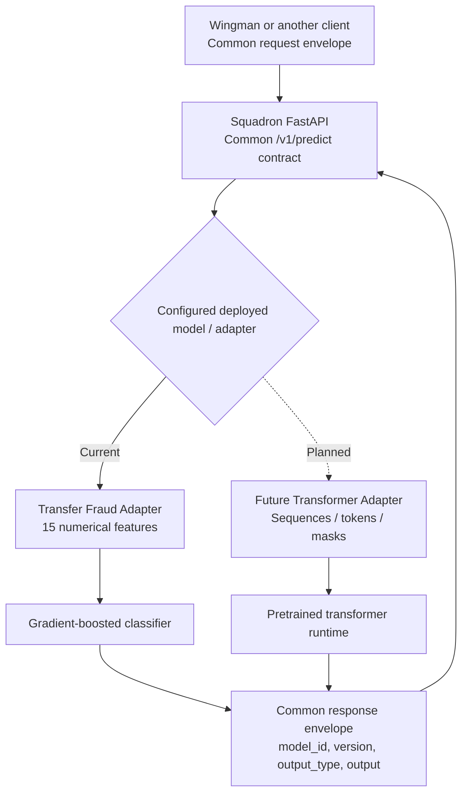

The initial service has **one configured model per instance**, not dynamic arbitrary model loading. A future transformer may return an **embedding**, and its `output_type` must reflect that; it is not automatically a fraud score.

### 8.3 FastAPI application behaviour

`services/squadron/main.py`:

- Registers `lifespan` startup/shutdown logic.
- Reads `MAVERICK_MODEL_DIR` (default `/models`).
- Instantiates `TransferFraudAdapter` **once at startup** and stores it in `app.state.adapter`.
- Exposes `GET /health/live` and `GET /health/ready`.
- Exposes `POST /v1/predict` with a Pydantic request/response schema.
- Returns **404** for an unknown / undeployed `model_id`.
- Converts adapter `ValueError` into **422**.
- Attaches model ID, pinned version and output type to the response.

### Diagram 13: User-requested simple HTTP inference flow

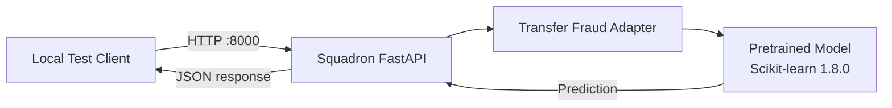

### Diagram 14: FastAPI startup and health probes

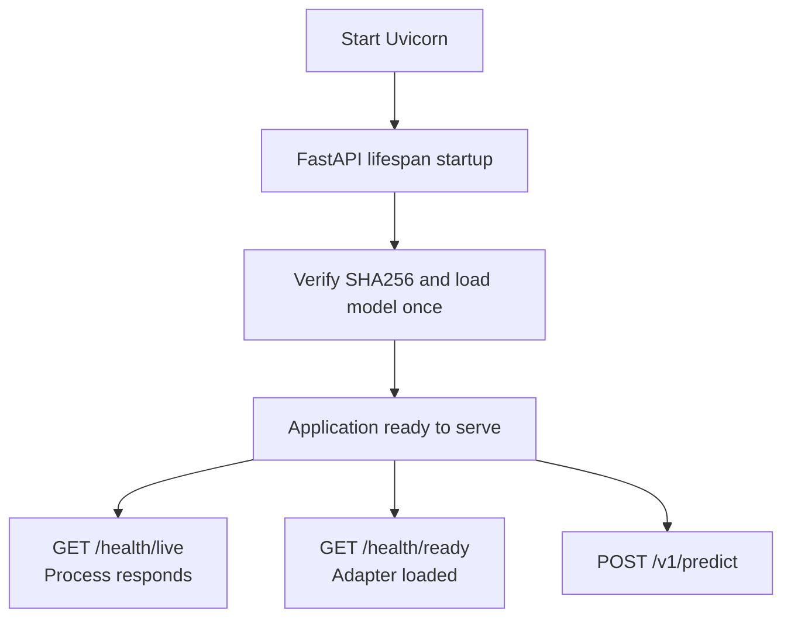

**Note:** `/health/live` checks the web process; `/health/ready` checks that the adapter was loaded during startup. For a stricter readiness definition, we may later validate a probe prediction and downstream health, without requiring Kafka or a database to be online for model-only serving.

### 8.4 API Dockerfile and dependencies

Pinned `services/squadron/requirements.txt`:

```text
fastapi==0.115.12
uvicorn==0.34.2
pydantic==2.11.4
scikit-learn==1.8.0
pandas==2.2.3
joblib==1.5.1
```

Dockerfile based on `python:3.12-slim` installs requirements, copies `contracts.py`, `main.py` and `adapters/`, sets CPU-thread/environment flags, runs as UID/GID `65534`, exposes container port `8000`, and starts:

```text
uvicorn main:app --host 0.0.0.0 --port 8000
```

Built with:

```bash
docker build -t maverick-squadron:0.1.0 services/squadron
docker images maverick-squadron
```

Observed:

```text
maverick-squadron:0.1.0
Image ID: a48bf7445b49
Docker-reported disk usage: 670MB
Docker-reported content size: 154MB
```

**What this image contains:** API code, adapter code and pinned Python runtime dependencies. **It does not contain** the pretrained model files; those were mounted from local WSL during the first HTTP test.

### Diagram 15: Initial Squadron container boundary

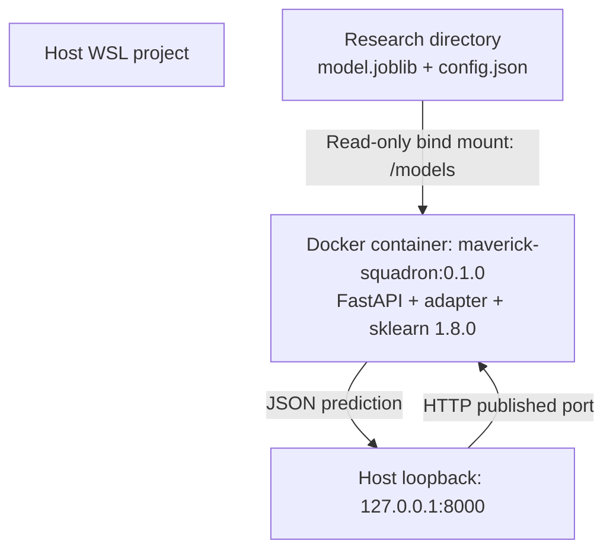

The local HTTP container did **not** use `--network none` because that would prevent the ordinary host-to-container HTTP test. The restricted **offline inspector** used `--network none`. These are different execution profiles.

### 8.5 Launch the local HTTP container

Verified local launch configuration:

```bash
docker run -d --rm \
  --name maverick-squadron-local \
  -p 127.0.0.1:8000:8000 \
  --read-only \
  --cap-drop ALL \
  --security-opt no-new-privileges \
  --pids-limit 64 \
  --memory 768m \
  --cpus 1 \
  --user 65534:65534 \
  --tmpfs /tmp:rw,nosuid,nodev,size=64m \
  -e MAVERICK_MODEL_DIR=/models \
  -v "$(pwd)/research/model-candidates/transfer-fraud:/models:ro" \
  maverick-squadron:0.1.0
```

- `-d`: detached service that stays running after the terminal command returns.
- `-p 127.0.0.1:8000:8000`: host-local port mapping; the service is not directly published to the LAN.
- `--read-only` and `:ro`: prevent modifications to the container root and model directory.
- `--cap-drop ALL`, `no-new-privileges`, `--user`: reduce privilege.
- `--memory`, `--cpus`, `--pids-limit`: resource budgets.
- `-e`: model directory configuration without hardcoding the host path into Python.

Health checks:

```bash
docker logs maverick-squadron-local
curl -fsS http://127.0.0.1:8000/health/live
curl -fsS http://127.0.0.1:8000/health/ready
```

Expected liveness: `{"status":"alive"}`. Expected readiness: `{"status":"ready","model_id":"transfer-fraud-v1"}`. Individual health responses were not separately pasted back into the chat, so the progress log should not present their exact responses as captured evidence.

### 8.6 HTTP prediction test (last completed step)

The test client read the publisher's `config.json`, built:

```python
payload = {
    "transaction_id": "MAV-HTTP-001",
    "model_id": "transfer-fraud-v1",
    "inputs": config["example_input"]
}
```

It posted JSON to `http://127.0.0.1:8000/v1/predict`, parsed the returned JSON and asserted:

```python
assert result["output"] == {
    "fraud_probability": 0.997,
    "risk_level": 3,
    "risk_label": "critical"
}
```

User-observed terminal result:

```text
MAVERICK SQUADRON HTTP INFERENCE PASSED
```

**This is the end of our verified work for 6 November 2026.**

### Diagram 16: Detailed HTTP request sequence

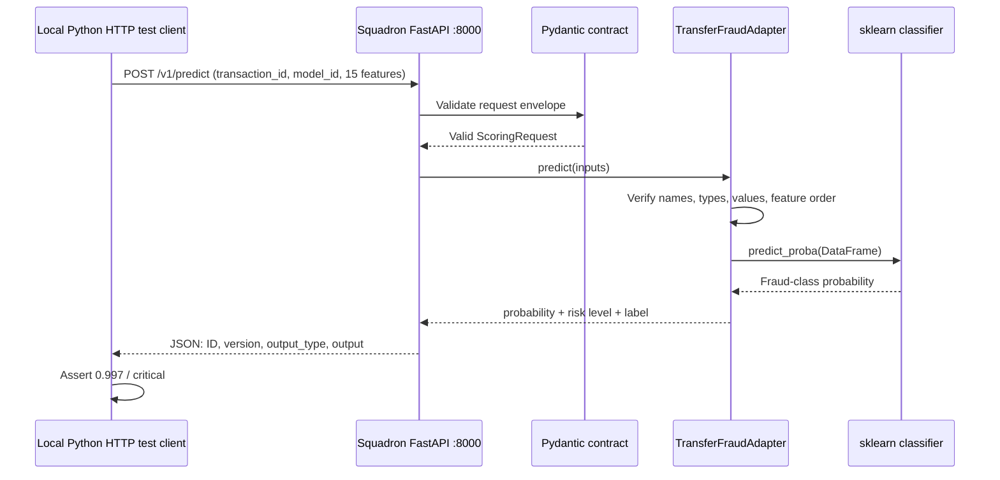

This validates the **HTTP layer + adapter + model** as one local path. It does **not** validate Kafka-to-HTTP integration.

---

## 9. Why we didn't train a transformer at this stage

We considered adapting NVIDIA's transaction foundation transformer to outbound-payment fraud. Its published use focuses on learned behavioural representations / embeddings rather than returning a calibrated outbound-transfer fraud probability unaided. Training or fine-tuning would add data, modelling, GPU, evaluation and maintenance problems unrelated to the immediate deployment proof.

Decision:

1. Start with an already-trained bank-transfer classifier to establish a fully functioning serving platform.
2. Preserve generic request/response envelopes and versioned model-specific adapters.
3. Later introduce a **different pretrained architecture**, such as a transformer, and prove that Squadron's external integration does not need redesign.
4. Never present a representation embedding as a fraud score without a legitimate trained downstream scoring component.

### Diagram 17: Separation of model development and model deployment

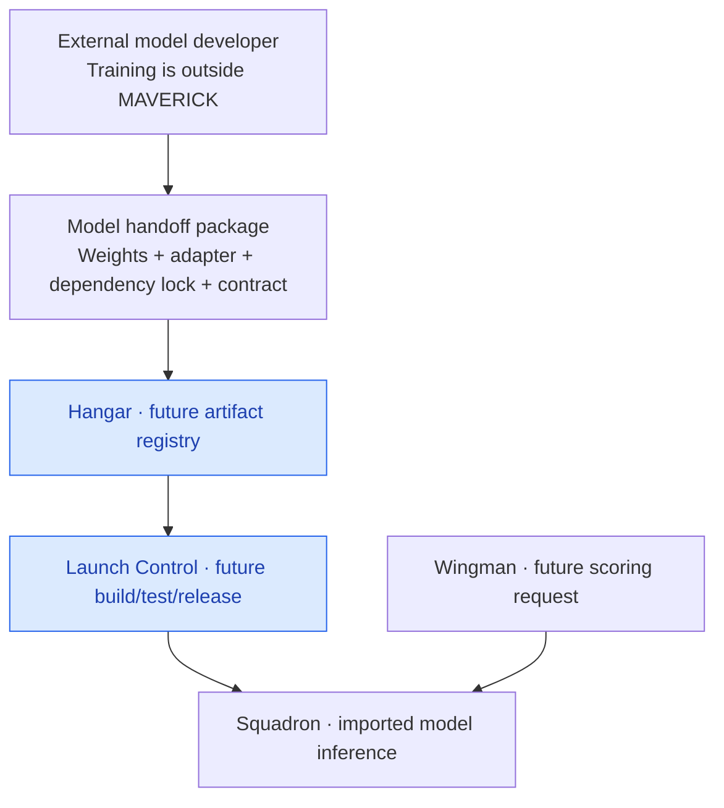

Hangar and Launch Control are **planned**, not deployed.

---

## 10. Shut down safely and resume another day

### Tonight: stop the running local Squadron container

```bash
docker stop maverick-squadron-local
```

This stops the FastAPI server. The container was launched with `--rm`, so its temporary container is removed when stopped. The Docker **image** and original WSL **source/model files** remain.

If the container was already stopped, Docker may return `No such container`; inspect `docker ps -a` before treating that as a problem.

### Stop MAVERICK Airbase (kind node containers)

First list the running kind nodes belonging to this project:

```bash
docker ps \
  --filter "label=io.x-k8s.kind.cluster=maverick-airbase" \
  --format '{{.Names}}'
```

Then stop those nodes:

```bash
docker ps \
  --filter "label=io.x-k8s.kind.cluster=maverick-airbase" \
  --format '{{.Names}}' \
  | xargs -r docker stop
```

The label filter ensures that this does **not** target unrelated Docker workloads. Stopping Docker node containers does **not intentionally delete** kind cluster definitions or Kubernetes persistent volumes, but cluster restart and Kafka recovery need verification. Avoid pruning volumes or deleting the cluster.

Verify stopped services:

```bash
docker ps
```

Optional: quit Docker Desktop. If desired, run `wsl --shutdown` from **Windows PowerShell**, after closing Docker Desktop. This is not necessary just to stop MAVERICK.

**Never use these as routine shutdown commands:** `kind delete cluster --name maverick-airbase`, `docker system prune --volumes`, `docker volume prune` or destructive PVC deletion.

### Resume: start the previously stopped cluster

1. Start Docker Desktop and open Ubuntu.
2. Start the saved kind node containers:

```bash
docker ps -a \
  --filter "label=io.x-k8s.kind.cluster=maverick-airbase" \
  --format '{{.Names}}' \
  | xargs -r docker start
```

3. Check Kubernetes health:

```bash
kubectl get nodes --context kind-maverick-airbase
kubectl get pods,pvc -n maverick-command
kubectl rollout status statefulset/maverick-flightline-kafka \
  -n maverick-command --timeout=240s
```

4. If desired, relaunch local Squadron with the original `docker run` command in section 8.5. The old `maverick-squadron-local` container was ephemeral and needs recreating.

5. Re-run local health checks and a known fixture prediction before changing code.

If Docker containers have been deleted rather than stopped, the restart procedure will not recreate them automatically. Do not recreate Kafka state or a cluster without first checking storage preservation.

### Diagram 18: Stop / restart lifecycle

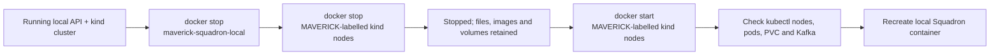

---

## 11. Next session: Controlled plan and acceptance criteria

**Start at this line. Do not skip to Kubernetes until the release artifact itself has been tested.**

| Order | Work | What must be demonstrated |
| ---: | --- | --- |
| 1 | Verify saved Airbase state and locally built images | Kubernetes recovers and `maverick-squadron:0.1.0` exists |
| 2 | Recheck `model.joblib` SHA256 | Artifact matches the pinned local baseline |
| 3 | Build a **self-contained** `maverick-squadron:0.2.0` image from `0.1.0` plus the pinned model and config | Model works **without** the WSL bind mount |
| 4 | Run one restricted local release-image HTTP test | Same `0.997` reference probability and correct model version |
| 5 | Load image into kind | `kind load docker-image maverick-squadron:0.2.0 --name maverick-airbase` succeeds |
| 6 | Write/apply `infrastructure/squadron/` Deployment + internal Service | Pod ready; probes pass; service discoverable in `maverick-command` |
| 7 | Invoke Squadron from inside Kubernetes | Internal-cluster HTTP inference reproduces baseline |
| 8 | Investigate feature compatibility and historical storage | Design and tests for amount unit, timezone, beneficiaries, trailing windows |
| 9 | Convert Wingman into a sustainable scoring worker | Kafka→Squadron integration with retries, idempotency and clear offset semantics |
| 10 | Add scored Kafka topic, Blackbox and Radar | Versioned results retained and visible independently of the originating payment system |

### Diagram 19: Immediate planned Kubernetes deployment

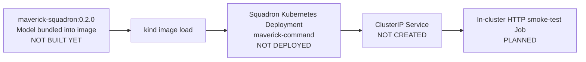

### Diagram 20: Future end-to-end scored-event lifecycle

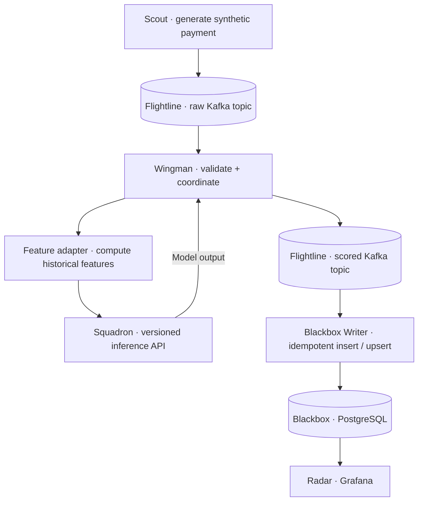

**Everything beyond the current local Squadron HTTP test is a proposed target, not completed functionality.**

### Key design decisions and unresolved questions

- **Decision:** one versioned model per Squadron serving deployment for the first iteration.
- **Decision:** model-specific preprocessing / encoding is packaged with its adapter.
- **Decision:** generic API wrapper retains `transaction_id`, `model_id`, `model_version`, `output_type` and `output`.
- **Decision:** synthetic transactions, no real customer data.
- **Unresolved:** publisher's model-training currency / amount unit versus Scout GBP minor units.
- **Unresolved:** construction, persistence and time-ordering of 180-day transaction history.
- **Unresolved:** customer-local timezone and beneficiary identifier in Scout schema.
- **Unresolved:** end-to-end retry, timeouts, dead-letter strategy, at-least-once effects and idempotent writes.
- **Unresolved:** exact deployment latency requirements and performance budget.
- **Unresolved:** independent model artifact trust/provenance attestation (a local checksum is insufficient).
- **Unresolved:** cloud/GKE demonstration timing and potential cost.
- **Unresolved:** GitHub sync / repository source-code hygiene; the public GitHub journal does not automatically publish local code.

---

## 12. Living journal: Add an entry after every working session

Each time MAVERICK changes, append one entry using this template. **Document what ran and what was observed**, not only what we intended.

```markdown
### Session YYYY-MM-DD — [short outcome]

**Starting point:** [last verified milestone]
**Session objective:** [one measurable objective]

**Files created or modified:**
- [repo-relative path and why]

**Commands executed:**
```

In future sessions, place fenced command examples **inside** the new entry, followed by their expected and observed outputs.

**Tests and evidence:** [exact console output, passing conditions, failures]
**Issues and resolution:** [including dependency versions and error messages]
**Architecture changes:** [updated Mermaid diagrams or links to changed diagrams]
**Decisions and trade-offs:** [why and what was deliberately deferred]
**Operational state at close:** [running / stopped, images, deployments, ports]
**Next session entry point:** [first specific command or check]
**Commit:** [Git SHA or link]

### Session 2026-11-06 — First independently served payment fraud prediction

**Completed:** Scout→Flightline→Wingman smoke test already verified; imported pinned third-party classifier; detected scikit-learn 1.9.1/1.8.0 model mismatch and fixed runtime; reproduced fixture prediction; created model adapter; created generic Pydantic contract and FastAPI endpoints; built `maverick-squadron:0.1.0`; received `MAVERICK SQUADRON HTTP INFERENCE PASSED`.

**Evidence:** Scout 100/0; Wingman 100 accepted/1 skipped; smoke-test result 0.997/critical; adapter test passed; HTTP inference assertion passed.

**Open work:** Model not yet bundled into release image; no Squadron Kubernetes deployment; no Kafka-to-scoring integration.

**Next entry point:** Check saved Docker/Kubernetes resources, then build and test a self-contained `maverick-squadron:0.2.0` image.

---

## 13. Repository and security hygiene

- The public GitHub repository is [sufyanbk/maverick](https://github.com/sufyanbk/maverick).
- This file is a **journal**, not an automatic sync of the WSL working directory.
- Before pushing source, inspect `git status` and a suitable `.gitignore`; do not commit credentials, real banking identifiers, local personal paths, exported transaction records or Docker-layer secrets.
- Keep the downloaded community `model.joblib` outside the public source tree unless model licence, redistribution intent, provenance and repository size are reviewed. A reproducible download with an immutable revision and recorded SHA256 is a clearer initial approach.
- Keep **observed**, **planned** and **failed** statuses distinct.
- Capture component-level Mermaid diagrams as each new component is introduced.
- Change the journal on the **same day as new verification**, not at an arbitrary later milestone.
